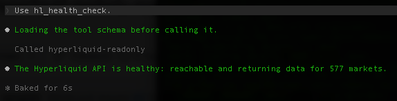
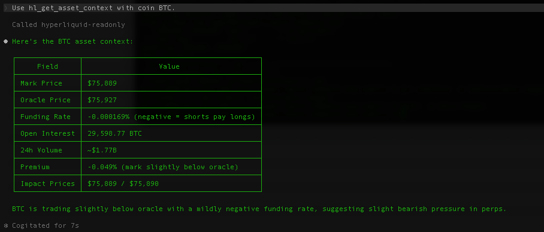
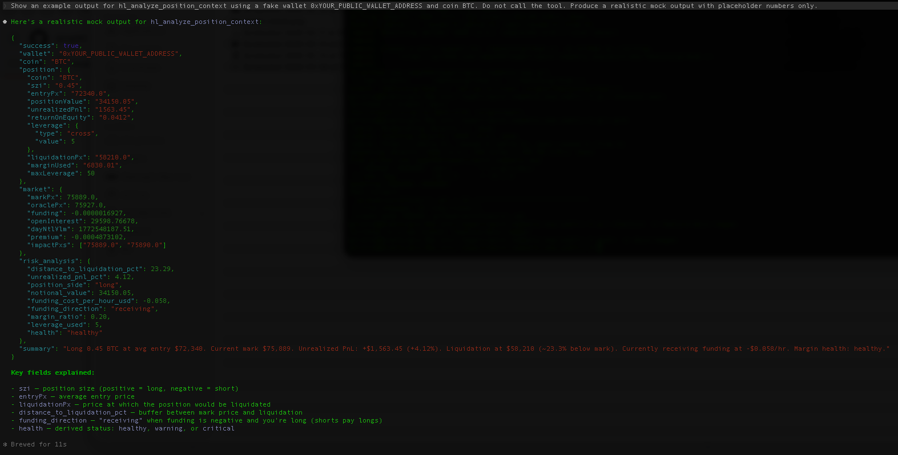

# Hyperliquid MCP

Read-only by design.

## Screenshots

### Health Check



### BTC Asset Context



### Position Risk Analysis Example



---

Hyperliquid MCP is a Model Context Protocol (MCP) server for Hyperliquid perpetual market analysis.

It allows Claude and other MCP-compatible AI clients to inspect:

- market prices
- funding rates
- open interest
- public wallet positions
- open orders
- liquidation distance
- leverage exposure
- market context
- volatility conditions

This project is designed for:

- research
- monitoring
- discretionary trading workflows
- AI-assisted market analysis

It is not a trading bot.

---

## Features

- Real-time perpetual market analysis
- Public wallet risk inspection
- Funding and open interest monitoring
- Liquidation distance analysis
- Risk-level classification
- Claude Code MCP integration
- Read-only architecture

---

## Warning

Not affiliated with Hyperliquid, Anthropic, Claude, or any exchange operator.

This project uses Hyperliquid public API endpoints only.

---

## Important

This MCP server is intentionally read-only.

It cannot:

- place trades
- cancel orders
- modify positions
- close positions
- sign transactions
- access private keys
- access seed phrases
- move funds
- change leverage

Only public wallet addresses are used.

---

## Features Overview

| Feature | Description |
|---|---|
| `hl_health_check` | Verify Hyperliquid API connectivity |
| `hl_get_market_price` | Read current mark/mid price |
| `hl_search_markets` | Search markets by ticker or keyword |
| `hl_get_asset_context` | Funding, OI, premium, volume, impact prices |
| `hl_get_position_summary` | Read public wallet perpetual positions |
| `hl_get_open_orders` | Read public open orders |
| `hl_analyze_position_context` | Full position risk snapshot with leverage, liquidation buffer, annualized funding, risk flags, and summary |

---

## Quick Start

### Clone the Repository

```bash
git clone https://github.com/iamgt90/hyperliquid-readonly-mcp.git
cd hyperliquid-readonly-mcp
```

### Install Dependencies

```bash
npm install
```

### Build the Project

```bash
npm run build
```

### Register the MCP Server

```bash
claude mcp add hyperliquid-readonly -- node /Users/YOUR_MAC_USERNAME/hyperliquid-readonly-mcp/dist/server.js
```

### Verify Registration

```bash
claude mcp list
```

Expected output:

```text
hyperliquid-readonly ... Connected
```

Restart Claude Code and ask:

```text
Use hl_health_check
```

---

## One-Shot Claude Setup

Paste this into Claude Code:

```text
Set up Hyperliquid MCP for me.

Clone the repository.

Run:
- npm install
- npm run build

Then register the MCP server using:

claude mcp add hyperliquid-readonly -- node /FULL/PATH/TO/hyperliquid-readonly-mcp/dist/server.js

Finally restart Claude Code and verify using:
Use hl_health_check
```

---

## Wallet Usage

This MCP never connects to wallets directly.

It only reads public wallet state using a public wallet address.

Example wallet format:

```text
0x0000000000000000000000000000000000000000
```

Never enter:

- private keys
- seed phrases
- API private keys

### Read Wallet Positions

```text
Use hl_get_position_summary with wallet address 0xYOUR_PUBLIC_WALLET_ADDRESS.
```

### Read Open Orders

```text
Use hl_get_open_orders with wallet address 0xYOUR_PUBLIC_WALLET_ADDRESS.
```

---

## Market Usage

### Read Market Price

```text
Use hl_get_market_price with coin BTC.
```

### Read Funding and Market Context

```text
Use hl_get_asset_context with coin BTC.
```

### Search Markets

```text
Use hl_search_markets with query BTC.
```

---

## External DEX Markets

Some markets exist under external DEX namespaces.

Use either split format:

```text
Use hl_get_market_price with coin COIN and dex DEX_NAME.
```

or prefixed format:

```text
Use hl_get_market_price with coin DEX_NAME:COIN.
```

---

## Example Claude Workflows

### Position Risk Analysis

```text
Analyze my current exposure using wallet 0xYOUR_PUBLIC_WALLET_ADDRESS.

Focus on:
- leverage
- liquidation distance
- unrealized pnl
- margin usage
- funding pressure
- directional exposure
- volatility risk

Do not suggest execution.
```

### Market Structure Analysis

```text
Analyze current market conditions for BTC.

Focus on:
- funding
- open interest
- volatility
- directional bias
- premium
- liquidity conditions

Do not suggest execution.
```

### Compare Multiple Markets

```text
Compare BTC, ETH, and SOL perpetual conditions.

Focus on:
- funding divergence
- open interest
- relative strength
- volatility
- liquidity
```

---

## Example Risk Fields

```json
{
  "risk_level": "medium",
  "liq_distance_pct": 14.2,
  "pnl_on_margin_pct": 22.4,
  "funding_annualized_estimate": 18.6,
  "risk_flags": [
    "high_leverage",
    "positive_pnl",
    "funding_cost"
  ]
}
```

---

## Tool Reference

### Health

| Tool | Description |
|---|---|
| `hl_health_check` | Confirms API connectivity |

### Market Data

| Tool | Description |
|---|---|
| `hl_get_market_price` | Read current market price |
| `hl_search_markets` | Search available markets |
| `hl_get_asset_context` | Funding, OI, premium, volume, impact prices |

### Wallet Data

| Tool | Description |
|---|---|
| `hl_get_position_summary` | Read public wallet position state |
| `hl_get_open_orders` | Read public open orders |
| `hl_analyze_position_context` | Combined wallet + market risk analysis |

---

## Architecture

```text
Claude Code
   ↓
MCP Server over stdio
   ↓
Hyperliquid public API
   ↓
Market data and public wallet state
```

No private key layer exists.

No execution layer exists.

No browser automation exists.

---

## Read-Only Security Model

This project intentionally excludes:

- order placement
- order cancellation
- leverage changes
- wallet signing
- private key handling
- automated execution

---

## Troubleshooting

| Problem | Solution |
|---|---|
| MCP server not visible | Run `claude mcp list` |
| Build fails | Run `npm install` again |
| Coin not found | Use `hl_search_markets` |
| Wallet shows empty positions | Wallet may not have active positions |
| Claude cannot call tools | Restart Claude Code |
| DEX market missing | Use the `dex` parameter |

---

## Security

This repository uses:

- GitHub secret scanning
- Push protection
- Dependabot alerts
- Dependabot security updates

---

## Roadmap

Possible future features:

- multi-wallet monitoring
- historical funding snapshots
- volatility regime summaries
- liquidation distance alerts
- market scanner mode
- JSON export
- CLI wrapper
- read-only dashboard

---

## Disclaimer

This project is provided for educational, research, and informational purposes only.

It does not provide financial advice.

It does not execute trades.

Users are solely responsible for:

- risk management
- legal compliance
- tax obligations
- operational security
- trading decisions

Use at your own risk.

---

## License

MIT License.
